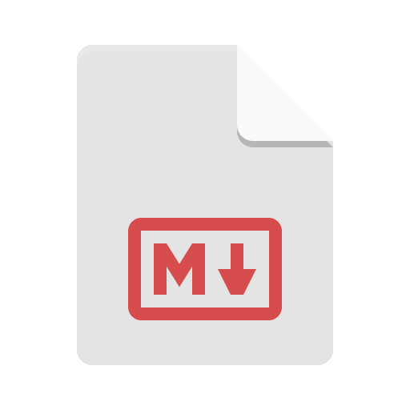

# Pre-Mecatrónica

Laboratorio centralizado autodidacta y monorepo de desarrollo práctico autodidacta Pre-Mecatrónica.

* -- Teoría creada por Claude AI. --
* -- Educación guiada por Claude AI. --
* -- Prácticas independientes sin intervención de AI. --

## Descripción del Repositorio

Por medio de este repositorio se conocerá y practicará de forma autodidacta las bases necesarias para la Ingeniería Mecatrónica en la actualidad.

Este repositorio usa la licencia [MIT](/LICENSE), por lo que cualquier persona puede hacer uso de este para aprender, replicar o usar sin ningún compromiso y totalmente gratis, siempre que respete y tenga en cuenta lo que se aclara en la Licencia.

## Tecnología Usadas

<!-- markdownlint-disable MD033 -->
* Markdown 
<!-- * Python  -->

## Roadmap

Este repositorio estará basado en un roadmap por **20** niveles y un **proyecto final**, los cuales son:

| **Nivel** | **Título** | **Carpeta** |
| :---: | :---: | :---: |
| **0** | Entorno de trabajo, Git y método de estudio | [Nivel 0](/Nivel%200/) |
| **1** | Aritmética y álgebra esencial | |
| **2** | Funciones y trigonometría | |
| **3** | Geometría | |
| **4** | Álgebra lineal | |
| **5** | Cálculo diferencial | |
| **6** | Cálculo integral | |
| **7** | Física mecánica | |
| **8** | Lógica de programación con Python | |
| **9** | Programación orientada a objetos | |
| **10** | Circuitos eléctricos | |
| **11** | Electrónica analógica | |
| **12** | Electrónica digital | |
| **13** | Microcontroladores y sistemas embebidos | |
| **14** | Probabilidad y estadística | |
| **15** | Ecuaciones diferenciales y sistemas dinámicos | |
| **16** | Diseño asistido por computador (CAD) | |
| **17** | Control y automatización | |
| **18** | Robótica | |
| **19** | IoT, visión por computador y Machine Learning | |
| **Proyecto Final** | Brazo robótico inteligente | |

## Referencias

<!-- markdownlint-disable MD033 -->
Los íconos fueron tomados de:

* [Flaticon](https://www.flaticon.es/) 
* [Icon-Icons](https://www.icon-icons.com/) 

<!-- * El documento .gitignore fue creado con la ayuda de [gitignore.io](https://www.toptal.com/developers/gitignore) -->

## Licencia

Para mayor información leer [LICENSE](/LICENSE)
